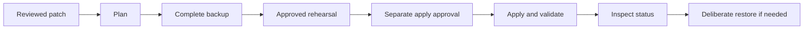

# DevCheckpoint

Verify complete Git snapshots, rehearse proposed patches, and recover safely when exact repository checks permit it.

[](LICENSE)
[](docs/verification.md)
[](package.json)
[](https://github.com/coro-9/devcheckpoint-cli/actions/workflows/windows.yml)
[](https://github.com/coro-9/devcheckpoint-cli/releases/tag/v0.1.2)

[Quick Start](#windows-quick-start--no-installation) · [Workflow](#one-complete-workflow) · [Benchmarks](#measured-storage-savings) · [Security](SECURITY.md) · [Arabic](docs/README.ar.md) · [Contributing](CONTRIBUTING.md)

**Verify a snapshot. Rehearse a patch. Apply deliberately. Refuse destructive recovery.**

DevCheckpoint is a small, dependency-free Node.js CLI for local Git repositories. It preserves current working files—including staged, modified, untracked and ignored content—then checks a proposed patch series in a disposable reconstruction before allowing an explicitly confirmed application.

It works independently of coding agents, accounts and APIs. Codex or another agent can invoke the same CLI through a shell. It does not modify Codex itself.

## Key features

- Complete local snapshots include Git history and staged, modified, untracked and ignored files.
- Ordered patch rehearsal verifies exact preimages, postimages and restoration in an independent working copy.
- Separate command approval and apply/restore confirmation keep execution deliberate.
- Drift detection stops recovery before overwriting unknown edits.
- Read-only doctor and checkpoint status explain prerequisites and recorded evidence.
- Lightweight single-patch planning and successful-workspace cleanup reduce temporary storage.



> Validation commands run with your privileges and are **not sandboxed**. Backups may contain secrets. Stop other repository writers and read the [security boundaries](SECURITY.md) before using a real project.

## Status and support

Version 0.1.2 is a conservative MVP. Verified environments and actual test results are recorded in [verification.md](docs/verification.md). Windows remains the qualified baseline; Linux/macOS are **not qualified** by this delivery. The hosted Windows CI workflow has passed; inspect [the actual successful run](https://github.com/coro-9/devcheckpoint-cli/actions/runs/38318913967).

Supported transactions: self-contained, non-bare Git repositories with an existing commit; ordered text/binary patches adding, modifying or deleting regular files. Repositories must be idle. Supply canonical full repository paths; Windows 8.3 aliases are rejected when they differ from Git's resolved root. No linked worktrees, submodules, external Git object stores, hard links, alternate streams, EFS, or special files. Link objects can be backed up as metadata without traversal, but rehearsal/apply refuse repositories containing links. See [LIMITATIONS.md](LIMITATIONS.md).

## Windows Quick Start — no installation

Requires Node.js 24 or newer, Git, and (on Windows) Windows PowerShell and `icacls` on PATH. No runtime npm dependencies or installation step is needed:

Extract the reviewed ZIP to a local directory, open PowerShell there, then run:

```powershell
node bin/devcheckpoint.mjs --version
node bin/devcheckpoint.mjs --help
node bin/devcheckpoint.mjs doctor
npm run example
```

The example creates only a fresh synthetic repository and private evidence in your temporary directory. It exercises plan, backup, rehearsal, apply, deliberate restore and a failed validation with recovery. It never tests against the tool's own checkout. For development checks, run `npm test` and `npm run check`. No registry package, global installation or account is needed.

`doctor` checks prerequisite availability and versions. `doctor --repo "C:\Projects\example-app"` additionally inspects the supported Git layout without a full content hash. Detailed filesystem checks (links, hard links, streams and exact bytes) remain deferred to plan/rehearse. Neither doctor nor help/version creates snapshots or runs validators. Node.js 24 or newer is enforced before transactional work.

## One complete workflow

Run from the unpacked tool directory. Stop editors that write files, watchers, builds and background jobs in the target repository first. Put patches, configuration and snapshots outside that repository.

Obtain a reviewed patch made **against the target's current preimage**, while leaving that target unchanged. For example, for a clean target at commit `BASE`, make changes and commit them in a separate ordinary development clone, then export there with `git diff --binary --output=C:/Changes/01.patch BASE PROPOSED`. Use the actual commit IDs in place of `BASE` and `PROPOSED`. Do not apply that patch back to the already-modified development clone. A target with uncommitted work requires a proposed patch based on those exact current bytes; a branch diff alone may not apply. Review applicability with `plan` instead of resetting local work.

Save the [configuration below](#validation-configuration) as `C:\Changes\checks.json`, adapting the file names to the target. This complete example uses one patch; repeat `--patch` in the intended order for a series.

```sh
node bin/devcheckpoint.mjs doctor --repo "C:\Projects\example-app"
node bin/devcheckpoint.mjs plan --repo "C:\Projects\example-app" --patch "C:\Changes\01.patch" --config "C:\Changes\checks.json"
node bin/devcheckpoint.mjs backup --repo "C:\Projects\example-app" --backup-dir "C:\Recovery\example-before-change"
node bin/devcheckpoint.mjs rehearse --repo "C:\Projects\example-app" --backup-dir "C:\Recovery\example-before-change" --patch "C:\Changes\01.patch" --config "C:\Changes\checks.json" --approve-commands
node bin/devcheckpoint.mjs status --backup-dir "C:\Recovery\example-before-change"
```

For one patch, `plan` checks Git applicability read-only without copying the repository. It does **not** establish exact postimages or validate the project; `rehearse` still does that. An ordered multi-patch plan needs one complete disposable copy to check dependent patches. Successful rehearsal removes its restored, byte-verified workspace; the snapshot, patches, receipts, journal and recovery evidence stay. Failure workspaces stay too. See [0.1.1 storage measurements](docs/disk-usage-0.1.1.md).

Read the plan and private rehearsal evidence. Only after the human approves real-checkout adoption:

```sh
node bin/devcheckpoint.mjs apply --repo "C:\Projects\example-app" --backup-dir "C:\Recovery\example-before-change" --confirm --approve-commands
node bin/devcheckpoint.mjs status --backup-dir "C:\Recovery\example-before-change" --verify --repo "C:\Projects\example-app"
```

Apply uses the **same copied patches, command configuration and exact per-stage hashes** sealed by rehearsal. It does not accept replacement patches. Each snapshot supports one rehearsal receipt and one adoption transaction. Start with a new snapshot for a different change.

To undo that adoption deliberately:

```sh
node bin/devcheckpoint.mjs restore --repo "C:\Projects\example-app" --backup-dir "C:\Recovery\example-before-change" --confirm
node bin/devcheckpoint.mjs status --backup-dir "C:\Recovery\example-before-change" --verify --repo "C:\Projects\example-app"
```

Restore refuses later edits, including edits to a file the patch changed. Preserve and reconcile those edits yourself; there is no force-overwrite flag. Restore is transaction-scoped, not a general disaster-recovery overwrite command for arbitrary lost directories.

## Validation configuration

See [examples/checks.json](examples/checks.json). Commands are argv arrays, executed without a shell. Names must be unique strings containing only letters, digits, `_` or `-`. Omitted `timeoutMs` defaults to 120000 ms. A supplied value must be an integer from 1 to 3600000 inclusive; zero, null, booleans, strings, fractions and out-of-range values are rejected before execution. `node` selects the current Node executable. `{tool}`, `{reporter}`, and `{evidence}` expand to the tool directory, the Node reporter's file URL, and a fresh external test-evidence path.

```json
{
  "version": 1,
  "commands": [
    { "name": "syntax", "kind": "command", "argv": ["node", "--check", "app.mjs"] },
    { "name": "unit", "kind": "tests", "argv": ["node", "--test", "--test-reporter={reporter}", "app.test.mjs"], "timeoutMs": 120000 }
  ]
}
```

Commands must leave repository content and Git metadata unchanged. Configure builds to write to external temporary output, or use read-only checking commands. A command that modifies the checkout blocks PASS. Unknown writes also block automatic restoration.

`--approve-commands` is explicit approval to execute the reviewed commands **with your privileges and network access**. Rehearsal changes the working directory; it is not a sandbox. There is no automatic dependency installation or network restriction. Never approve untrusted commands. Use only terminating commands, not servers/watchers or commands leaving child processes behind.

Test commands require fresh machine-readable evidence. The included Node reporter reconciles actual test terminal events with the runner summary and refuses empty, failed, skipped, cancelled, todo or incomplete runs. Other test frameworks can write the documented [evidence contract](docs/test-evidence.md). Plain command success is reported only as command success, never as a test-suite PASS. With no test commands configured, the report explicitly says patch verification only.

## Inspect an existing checkpoint

```powershell
node bin/devcheckpoint.mjs status --backup-dir "C:\Recovery\example-before-change"
node bin/devcheckpoint.mjs status --backup-dir "C:\Recovery\example-before-change" --verify
node bin/devcheckpoint.mjs status --backup-dir "C:\Recovery\example-before-change" --verify --repo "C:\Projects\example-app"
```

Default status validates recorded metadata/sidecars and reports snapshot, rehearsal and transaction evidence. It does **not** rehash all backup objects, inspect your live checkout, or establish that restoration is safe. `--verify` explicitly rehashes the complete backup. Only `--verify --repo PATH` also compares the named live repository with the applicable recorded baseline/postimage. Interrupted or incomplete state remains incomplete even when its metadata is readable. Status never repairs, clears locks, executes validators or grants permission; retain all evidence if it reports corruption or drift.

## Recovery and output

The CLI prints concise JSON results; progress goes to stderr. Raw Git warnings and command output are retained in the private snapshot, not printed. Journals, receipts and SHA-256 manifests are local. They may contain sensitive filenames and command output; do not publish them.

If a command fails normally and all current entries are known transaction states, DevCheckpoint preserves changed bytes in recovery objects and restores the exact baseline. If a process times out, an unknown edit appears, or an interrupted restore leaves ambiguous state, it stops for reconciliation. A cooperative lock prevents concurrent DevCheckpoint operations. After verifying all writers have stopped, `restore --confirm --recover-lock` can clear a lock only when its recorded PID no longer exists. It never terminates that PID.

Free-space estimates run before expensive copies and before apply/restore writes. Demands on the same volume are combined, with conservative metadata, output and recovery allowances plus 64 MiB headroom per volume. This checks current availability; it does not reserve space or bound arbitrary validators. Space consumed later can still cause an ordinary failure or require reconciliation.

Exit codes: `0` success, `1` unexpected failure, `2` usage, `3` approval missing, `4` unsupported input, `5` integrity/drift, `6` Git/process failure, `7` validation failure (possibly restored), `8` recovery/reconciliation required, `9` lock held, `10` insufficient/unverifiable disk space. Inspect the result's recovery field; a nonzero exit never means adoption passed.

## Troubleshooting

| Condition | Safe next step |
|---|---|
| Missing Node/Git/PowerShell/icacls, wrong or missing path | Run `doctor`; make the required tool available yourself and supply the ordinary repository root. No automatic installation occurs. |
| Linked worktree, submodule, shallow/partial clone or unsupported file layout | Use a separately prepared supported self-contained repository; do not bypass checks or delete Git metadata. |
| Invalid configuration or missing approval | Correct the JSON/name/timeout and review the displayed argv. Supply approval flags only after authorization. |
| Validator writes repository files or leaves a process running | Configure external output and terminating commands; preserve evidence and stop writers before reconciliation. |
| Lock or interrupted operation | Identify the owning process first. Do not delete an unknown lock. Deliberate restore can use `--recover-lock` only after its PID is absent and writers are stopped. |
| Drift or ambiguous restore | Preserve newer work and reconcile against private evidence; never force an overwrite or edit a manifest to pass. |
| Exit 10 / disk capacity changes | Provide sufficient space on every involved volume and retry only after inspecting state. Estimates reserve nothing; never delete recovery evidence merely to continue. |

## Measured storage savings

These storage improvements were introduced in **0.1.1** and preserved in **0.1.2**. The same synthetic project contained 33 regular files totaling 8,421,113 bytes.

| Operation | 0.1.0 file bytes | 0.1.1 file bytes | Savings |
|---|---:|---:|---:|
| Single-patch plan temporary files | 16,852,200 | 1,212 | 99.99% |
| Ordered two-patch plan temporary files | 16,854,062 | 8,425,097 | 50.01% |
| Retained backup + successful rehearsal | 16,869,969 | 8,448,923 | 49.92% |

These are regular-file byte measurements from one synthetic project. They do not measure runtime, allocated disk clusters or guaranteed savings on other projects. Successful plan files are temporary; the rehearsal figure measures retained storage. Complete backups and failure evidence remain necessary. Read the [measurement method and limits](docs/disk-usage-0.1.1.md).

## Use with Codex

From the unpacked tool directory, give your agent an instruction such as:

> Use DevCheckpoint to inspect my reviewed patch against the unchanged target. Show the configured argv, then wait for my approval before executing validators. Make a complete external backup and rehearse. Report the actual results and stop for separate approval before apply or restore. Use status for inspection; never treat a passing check as permission.

The [short Codex guide](docs/codex.md) includes an optional instruction for your existing `AGENTS.md`. DevCheckpoint requires no coding-agent account or API, and never edits agent instructions automatically.

## Windows CI

[The workflow](.github/workflows/windows.yml) uses Windows and Node 24, records tool versions, and runs tests, syntax checks, the synthetic example, package dry-run, ZIP verification and extracted smoke. It has read-only repository permissions, pinned official actions, no persisted checkout credentials, dependencies, publishing or deployments. See the workflow's official-source links. The [hosted verification run](https://github.com/coro-9/devcheckpoint-cli/actions/runs/38318913967) passed tests, syntax checks, synthetic recovery, packaging and extracted smoke on Windows Server 2025 / Node.js 24.21.0. The runner uses its canonical temporary directory; strict repository checks remain unchanged.

## Review and contribute

- [Architecture](ARCHITECTURE.md), [security](SECURITY.md), [limitations](LIMITATIONS.md)
- [Arabic guide](docs/README.ar.md), [Codex instructions](docs/codex.md)
- [Synthetic demo](examples/demo.mjs), [contributing](CONTRIBUTING.md)
- [Changelog](CHANGELOG.md)

Report reproducible tool problems through [GitHub Issues](https://github.com/coro-9/devcheckpoint-cli/issues). Include tool versions and a minimal synthetic example; keep snapshots, credentials and private logs out of public reports. For contributions, follow [CONTRIBUTING.md](CONTRIBUTING.md). Security-report guidance is in [SECURITY.md](SECURITY.md).

The [v0.1.2 tag](https://github.com/coro-9/devcheckpoint-cli/tree/v0.1.2) and release ZIP preserve the exact verified source. This default-branch README includes subsequent publication presentation updates.

All project code is newly authored generic implementation under MIT. The design applies established snapshot, transaction, hashing and rollback techniques; it does not claim to invent them. No private application source, credentials, native assets or historical campaign data are included.
